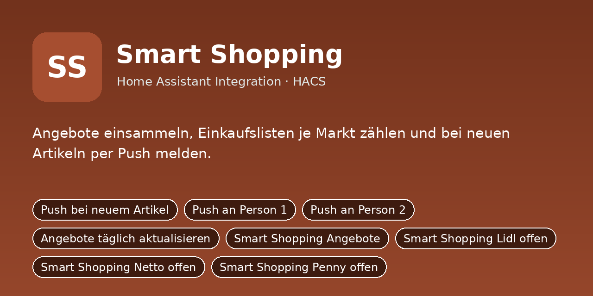
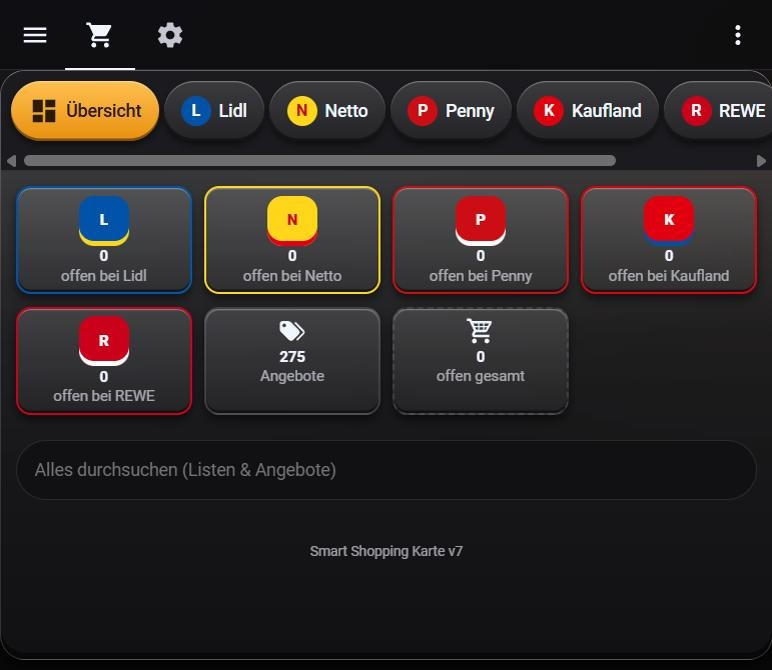

# Smart Shopping



Angebote einsammeln, Einkaufslisten je Markt zählen und bei neuen Artikeln per Push melden.



Python-Integration für Home Assistant (HACS). Sie ersetzt das bisherige YAML-Paket
`smart_shopping/packages/smart_shopping.yaml`: Einstellungen sind jetzt eigene Entitäten (Schalter, Zahlen, Auswahlfelder,
Uhrzeiten), die Logik läuft in Python statt in Automationen und Skripten.

## Installation

1. HACS → Integrationen → ⋮ → **Benutzerdefinierte Repositories** →
   `https://github.com/DerGnom1977/ha-smart-shopping-integration` als Kategorie **Integration** hinzufügen.
2. **Smart Shopping** installieren und Home Assistant neu starten.
3. Einstellungen → Geräte & Dienste → **Integration hinzufügen** → *Smart Shopping*.
4. Das Dashboard aus `dashboards/smart_shopping_dashboard.yaml` anlegen (Raw-Konfigurationseditor).

Manuell: Ordner `custom_components/smart_shopping` nach `/config/custom_components/` kopieren.

## Einrichtung

Beim Hinzufügen (und später über „Konfigurieren“) werden diese Angaben abgefragt:

- **Notify-Dienst Person 1** (`notify_person1`), Standard: `mobile_app_mein_handy`
- **Notify-Dienst Person 2** (`notify_person2`), Standard: `mobile_app_partner_handy`
- **Seite, die ein Tipp auf die Push-Meldung öffnet** (`push_url`), Standard: `/dashboard-einkaufsliste/einkauf`
- **To-do-Liste Lidl** (`liste_lidl`), Standard: `todo.lidl`
- **To-do-Liste Netto** (`liste_netto`), Standard: `todo.netto`
- **To-do-Liste Penny** (`liste_penny`), Standard: `todo.penny`
- **To-do-Liste Kaufland** (`liste_kaufland`), Standard: `todo.kaufland`
- **To-do-Liste REWE** (`liste_rewe`), Standard: `todo.rewe`

## Was du anpassen musst

Alle Standardwerte oben sind **Platzhalter/Beispiele**. Passe sie beim Einrichten an dein System an:

- **Notify-Dienste** (`notify_person1`, `notify_person2`): Name deines Handy-Dienstes ohne `notify.`,
  z. B. `mobile_app_mein_handy` → bei dir `mobile_app_<gerätename>` (Entwicklerwerkzeuge → Aktionen → „notify“).
  „Person 1/Person 2“ sind frei; die Schalter *Push an Person 1/2* schalten die jeweilige Meldung.
- **Entitäten** (`sensor.…`, `camera.…`, `person.…`, `todo.…` usw.): auf die echten Entitäts-IDs aus
  Einstellungen → Geräte & Dienste → Entitäten ändern. Leere Felder sind Pflicht, wenn die Funktion genutzt wird.
- **Dashboard** (`dashboards/smart_shopping_dashboard.yaml`): enthält Entitäts-IDs der Integration; wenn du Namen
  oder Räume änderst, dort per Suchen/Ersetzen nachziehen.
- Später jederzeit unter Einstellungen → Geräte & Dienste → *Smart Shopping* → **Konfigurieren** änderbar.

## Zugangsschlüssel für Angebote (marktguru, optional)

Die automatische Angebotsquelle `marktguru` ist standardmäßig **ausgeschaltet**. Zugangsschlüssel sind
**nicht** im Repository enthalten und gehören nie in `sources.json` oder in GitHub.

1. Datei `/config/smart_shopping/marktguru_keys.json` anlegen (Vorlage: `examples/marktguru_keys.example.json`):

   ```json
   {
     "apikey": "HIER DEIN API KEY EINFÜGEN",
     "clientkey": "HIER DEIN CLIENT KEY EINFÜGEN"
   }
   ```

2. `HIER DEIN API KEY EINFÜGEN` und `HIER DEIN CLIENT KEY EINFÜGEN` durch deine eigenen Schlüssel ersetzen.
3. In `/config/smart_shopping/sources.json` bei der Quelle `marktguru` `"enabled": true` setzen und
   `"zip_code"` (Platzhalter `12345`) auf deine Postleitzahl ändern.
4. Die Web-API ist inoffiziell. Nutzungsbedingungen selbst prüfen und höchstens einmal täglich abfragen.

## Umstieg vom YAML-Paket

1. Das alte Paket `smart_shopping/packages/smart_shopping.yaml` (und sein Dashboard) aus `/config/packages/` entfernen
   und Home Assistant neu starten, damit Helfer, Automationen und Skripte nicht doppelt laufen.
2. Integration einrichten. Neue Entitäten haben dieselben Namen wie die alten Helfer, nur mit
   anderer Domain, z. B. `input_boolean.xyz` wird `switch.xyz`, `input_number.xyz` wird `number.xyz`,
   `input_select.xyz` wird `select.xyz`, `input_datetime.xyz` wird `time.xyz`.
3. Eigene Automationen und Dashboards, die alte Entitäten nutzen, entsprechend anpassen.
4. Die alten Standardwerte sind schon eingebaut, die Einstellungen bleiben nach Neustarts erhalten.

## Dienste

- `smart_shopping.angebote_aktualisieren` – Ruft die Angebotsquellen ab.
- `smart_shopping.angebot_speichern` – Trägt ein Angebot von Hand ein.
- `smart_shopping.artikel_hinzufuegen` – Setzt einen Artikel auf die Liste (ohne Duplikate).

## Entitäten

### Schalter

- `switch.smart_shopping_push_aktiv` – Push bei neuem Artikel
- `switch.smart_shopping_ziel_person1` – Push an Person 1
- `switch.smart_shopping_ziel_person2` – Push an Person 2
- `switch.smart_shopping_taeglich_aktualisieren` – Angebote täglich aktualisieren

### Sensoren

- `sensor.smart_shopping_angebote` – Smart Shopping Angebote
- `sensor.smart_shopping_lidl_offen` – Smart Shopping Lidl offen
- `sensor.smart_shopping_netto_offen` – Smart Shopping Netto offen
- `sensor.smart_shopping_penny_offen` – Smart Shopping Penny offen
- `sensor.smart_shopping_kaufland_offen` – Smart Shopping Kaufland offen
- `sensor.smart_shopping_rewe_offen` – Smart Shopping REWE offen
- `sensor.smart_shopping_gesamt_offen` – Smart Shopping Gesamt offen

### Knöpfe

- `button.smart_shopping_angebote_aktualisieren` – Angebote aktualisieren
- `button.smart_shopping_abgelaufene_entfernen` – Abgelaufene Angebote entfernen
- `button.smart_shopping_standardwerte` – Standardwerte setzen

## Hinweis

Die Integration wurde aus dem bestehenden YAML-Paket portiert und ist noch nicht in einer laufenden
Home-Assistant-Instanz getestet. Bitte beim ersten Einsatz die Logbuch-/Protokoll-Meldungen
(`custom_components.smart_shopping`) im Blick behalten.
